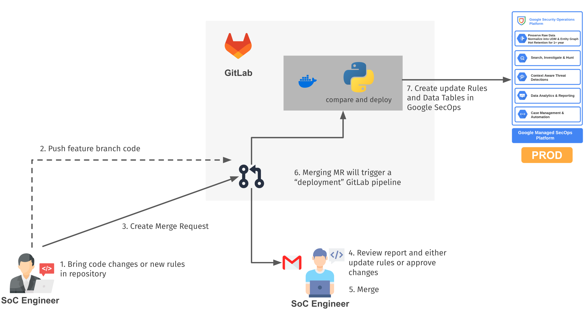

# Google SecOps Detection-as-Code (multitenant)



An enterprise-ready **Detection-as-Code (DaC)** framework and CI/CD pipeline for **Google Security Operations (SecOps)**, designed for **multitenant environments** (MSSPs, central SOCs, federated business units, and holding companies).

This repository enables security engineering teams to author, test, review, deploy, and audit detection content at scale across dozens or hundreds of SecOps tenants while maintaining a balance between **shared baseline policies** and **tenant-specific customizations**.

---

## Quick Start

This pipeline is meant to be run in large deployments, from a centralized CICD server.

However, you can start experimenting locally with the following quick steps:

### 1. Install Dependencies
Ensure Python 3.11+ is installed, then install required packages:
```bash
pip install secops google-auth pyyaml argcomplete requests
```

### 2. Authenticate
Authenticate using Google Cloud Application Default Credentials:
```bash
gcloud auth application-default login
```

### 3. Configure Tenant Inventory
Create `tenants.json` with your tenants information:
```json
{
  "prod": {
    "alfa": {
      "customerId": "<CHRONICLE_CUSTOMER_ID>",
      "gcpProject": "<GCP_PROJECT_ID>"
    },
    "bravo": {
      "customerId": "<CHRONICLE_CUSTOMER_ID>",
      "gcpProject": "<GCP_PROJECT_ID>"
    }
  }
}
```

You can specify multiple environments, in addition to the default `prod` one.

### 4. Compare, Verify & Simulate Deployment (YARA-L rules & deployment configs)
Inspect detection and deployment schedule drift against SecOps, verify rules via `verifyRuleText`, and simulate deployment safely:
```bash
# Compare local YARA-L rules and companion YAML deployment configs against SecOps
# (--debug shows full rule text and schedule customization diffs)
./pipelines/deployment/compare_rules.py --tenant=alfa --debug

# Verify YARA-L syntax and allowed run frequencies against Chronicle verifyRuleText
./pipelines/deployment/verify_rules.py --tenant=alfa

# Simulate deployment (rules, schedules, and archive state) without applying changes
./pipelines/deployment/deploy_rules.py --tenant=alfa --dry-run
```

---

## Tenant Lifecycle Model (Build vs. Live)

Tenants are categorized into two stages based on Git release tags:

| Stage | Definition | YARA-L Rule Structure | Curated Detections | Deployment Policy |
| :--- | :--- | :--- | :--- | :--- |
| **`build`** | Tenants currently in onboarding, testing, or tuning. | Symbolic links (`ln -s`) pointing to `rules/shared/` (`.yaral` and optional `.yaml`). | Symbolic links (`ln -s`) pointing to `curated/shared/`. | Deployed on commits to the development branch (`dev`). |
| **`live`** | Stabilized production tenants handed over to operations. | May be decoupled into standalone `.yaral` and `.yaml` files. | Symbolic links (`ln -s`) pointing to `curated/shared/`. | Deployed on commits to the production branch (`prod`). |

### Determining Live Status
A tenant is classified as **`live`** if the repository contains a Git tag matching:
```bash
<tenant_id>-handover*
# or
<tenant_id>-golive*
```
*Example:* `alfa-golive` or `bravo-handover-20250101`. Any tenant without a matching tag is treated as being in the **`build`** stage.

### Optional Live Tenant Rule Decoupling
Some organizations require that tenants in the `live` stage decouple their custom YARA-L rules and companion YAML deployment configurations from `rules/shared/` into independent standalone files to prevent accidental upstream updates from impacting production environments.

This check is **optional** and controlled by the `DAC_ENFORCE_LIVE_DECOUPLING` environment variable or the `--enforce` flag on `pipelines/code-quality/check_live_tenants.py`. When enabled, the script verifies that no symbolic links (`.yaral` or `.yaml`) exist in `rules/tenants/<live_tenant>/`.

> **Note on Curated Detections**: Because curated detections represent Google-managed threat intelligence rulesets, they cannot be modified or decoupled per tenant. Consequently, curated detections are **always symbolic links** pointing to `curated/shared/` for all tenants across all lifecycle stages.

---

## Repository Structure

```
secops-detection-as-code-multitenant/
├── curated/                              # Curated Detection Rule Sets
│   ├── shared/                           # Shared curated detection catalog definitions
│   │   ├── ATICP_ActiveBreachPriorityHostIndicators_precise.yaml
│   │   └── ...
│   └── tenants/                          # Per-tenant curated detection declarations
│       ├── alfa/                         # Symlinked to shared/
│       └── ...
│
├── rules/                                # YARA-L 2.0 Detection Rules & Deployment Configs
│   ├── shared/                           # Base rules and schedules shared across tenants
│   │   ├── ExternalLoginAttempt_Linux.yaral
│   │   └── ExternalLoginAttempt_Linux.yaml
│   └── tenants/                          # Tenant-specific rule directories
│       ├── alfa/                         # Symlinked to shared/ (build stage)
│       └── bravo/                        # Standalone decoupled rule & schedule (live stage)
│
├── tables/                               # Data Tables (Context & Reference Lists)
│   ├── shared/                           # Shared table schemas & default values (.yaml)
│   │   ├── ip_private_addresses.yaml
│   │   └── ...
│   └── tenants/                          # Per-tenant row overrides (.csv) or unique tables
│       └── bravo/
│           └── known_exposed_servers.csv # Overrides row entries for tenant 'bravo'
│
├── pipelines/                            # CI/CD & Automation Tooling
│   ├── gitlab-ci.yml                     # GitLab CI pipeline configuration
│   ├── code-quality/                     # Linter & validator scripts
│   └── deployment/                       # Core pipeline execution scripts
│
└── README.md
```

## Detection Components

### 1. YARA-L Rules & Companion Deployment Configurations
- **Location**: `rules/shared/` and `rules/tenants/<tenant_id>/`
- **Naming Rule**: The base filename must match the rule name inside the file:
  ```
  // File: rules/shared/ExternalLoginAttempt_Linux.yaral
  rule ExternalLoginAttempt_Linux {
  ```
- **Rule Text Format (`.yaral`)**: The YARA-L 2.0 text of the rule.
- **Companion Deployment Configuration (`.yaml`, optional)**: Each rule may define a companion `<RuleName>.yaml` file controlling Chronicle `v1` `RuleDeployment` state, run schedule, and scheduler customizations:
  ```yaml
  enabled: true
  alerting: true
  archived: false
  run_frequency: "LIVE_CUSTOMIZABLE"  # LIVE | LIVE_CUSTOMIZABLE | HOURLY_CUSTOMIZABLE | DAILY
  # Optional Data RBAC scope:
  # scope: "projects/<project>/locations/<region>/instances/<id>/dataAccessScopes/<scope>"
  # Optional scheduler customizations (valid only for LIVE_CUSTOMIZABLE or HOURLY_CUSTOMIZABLE):
  schedule_customizations:
    ensure_enrichment_completeness: false
    late_arriving_data_adjustment: "300s"
  ```
  - **Supported `run_frequency` values**:
    - `LIVE`: Near-real-time schedule for single-event rules (no `match:` window).
    - `LIVE_CUSTOMIZABLE`: Customizable high-frequency schedule (every ~10 minutes) for multi-event rules with a `match:` window `< 1h`.
    - `HOURLY_CUSTOMIZABLE`: Customizable hourly schedule for multi-event rules with a `match:` window `<= 2d`.
    - `DAILY`: Daily schedule for multi-event rules with a `match:` window `> 2d`.
    - *(Legacy `HOURLY` is deprecated by Google SecOps in favor of `HOURLY_CUSTOMIZABLE`; tools emit a migration warning unless `--strict` is specified).*
  - **Resolution Precedence**: When evaluating a rule for `<tenant_id>`, the pipeline resolves `rules/tenants/<tenant_id>/<RuleName>.yaml` first, falls back to `rules/shared/<RuleName>.yaml`, and if neither file exists, manages only the YARA-L rule text (preserving full backward compatibility).
- **Customization Pattern**: Onboarding tenants (e.g., `alfa`) symlink to the shared `.yaral` and `.yaml` files. A tenant can decouple its `.yaml` independently of `.yaral` (e.g., to disable alerting or adjust `late_arriving_data_adjustment` while keeping shared rule logic), or decouple both when custom YARA-L exclusions are required (e.g., `bravo`).

### 2. Curated Detection Rule Sets
- **Location**: `curated/shared/` and `curated/tenants/<tenant_id>/`
- **File Format**: YAML file containing the Google SecOps Rule Set ID and display name:
  ```yaml
  id: f5533b66-9327-9880-93e6-75a738ac2345
  name: Active Breach Priority Host Indicators
  ```
- **Filename Convention**: `<CategoryAbbreviation>_<RuleSetNameSanitized>_<precision>.yaml`
  - Example: `ATICP_ActiveBreachPriorityHostIndicators_precise.yaml`
  - Precision levels supported: `precise` or `broad`.
  - Since there is nothing to customize in Curated Detections, the suggested approach is to enable rule sets on a tenant and use the `pull_curated.py` script to bootstrap your repo.
- **Symlink Model**: Enabling a curated detection for a tenant is always done by creating a symbolic link in `curated/tenants/<tenant_id>/` targeting the definition in `curated/shared/`.

### 3. Data Tables
- **Location**: `tables/shared/` and `tables/tenants/<tenant_id>/`
- **Automatic Rule Discovery**: When YARA-L rules use the `%table_name` syntax, the pipeline automatically detects the dependency and verifies the table in SecOps.
- **Schema Definition (`tables/shared/<table_name>.yaml`)**:
  ```yaml
  description: >
    IP addresses of known exposed servers.
  columns:
    - main(cidr)*   # Column name, type (cidr/regex/string), and '*' for key column
    - comment       # Secondary string column
  default_values:
    - ["10.0.0.1/32", "Jump host"]
  ```
- **Tenant Rows Overrides (`tables/tenants/<tenant_id>/<table_name>.csv`)**:
  Tenants can supply their own row data without changing the schema definition. Creating a CSV with the matching table name overrides the `default_values` for that tenant:
  ```csv
  198.51.100.10,Web DMZ Server
  198.51.100.11,Mail Gateway
  ```

## Prerequisites & Setup

### Dependencies
Python 3.11 or later is required. Install necessary dependencies:
```bash
pip install \
  secops \
  google-auth \
  pyyaml \
  argcomplete \
  requests
```

Or use the included `pipelines/Dockerfile`.

### Google Cloud Authentication
Scripts authenticate via the official `google-auth` library:
- **Local Workstation**: Authenticate via Application Default Credentials (ADC):
  ```bash
  gcloud auth application-default login
  ```
- **Service Account Impersonation**: Pass `--impersonate-sa=<sa-email>` or set `export DAC_IMPERSONATE_SA="<sa-email>"`.
- **CI/CD Pipelines**: Run using Workload Identity Federation or inject service account credentials via environment variables.

### Tenant Inventory Configuration
Tenant connection parameters are stored in a central JSON file (specified via `--tenants-file` or `DAC_TENANTS_FILE`).

Create your inventory file (e.g. `tenants.json`):
```json
{
  "dev": {
    "alfa": {
      "customerId": "00000000-0000-0000-0000-000000000001",
      "gcpProject": "secops-dev-project"
    }
  },
  "prod": {
    "alfa": {
      "customerId": "11111111-1111-1111-1111-111111111111",
      "gcpProject": "secops-prod-project"
    },
    "bravo": {
      "customerId": "22222222-2222-2222-2222-222222222222",
      "gcpProject": "secops-prod-project"
    }
  }
}
```

### Environment Variables
Configure default paths and settings through environment variables:

| Variable | Description | Default |
| :--- | :--- | :--- |
| `DAC_TENANTS_FILE` | Path to the tenant credentials JSON file | `./tenants.json` |
| `DAC_RULES_DIR` | Path to the local YARA-L rules directory | `./rules` |
| `DAC_CURATED_DIR` | Path to local curated detection definitions | `./curated` |
| `DAC_TABLES_DIR` | Path to local Data Table definitions | `./tables` |
| `DAC_IMPERSONATE_SA` | Service account email to impersonate | `None` |
| `DAC_ENFORCE_LIVE_DECOUPLING` | When set to `true`, enforces that live tenants have no symlinked YARA-L or YAML rule files | `""` (disabled) |
| `DAC_STRICT_RULE_CONFIGS` | When set to `true`, treats legacy/deprecated schedule warnings in `check_rule_configs.py` as errors | `""` (disabled) |
| `DAC_RULES_DELTAS_FILE` | Destination path for YARA-L comparison deltas | `""` |
| `DAC_CURATED_DELTAS_FILE` | Destination path for curated comparison deltas | `""` |
| `DAC_TABLES_DELTAS_FILE` | Destination path for tables comparison deltas | `""` |

## How to Use (CLI Reference)

All deployment and comparison scripts accept standardized arguments:
- `-e, --env`: Environment to target (`dev` or `prod`, defaults to `prod`).
- `-p, --tenant`: Code of tenant to process (can be specified multiple times).
- `-s, --stage`: Process all tenants in a given stage (`all`, `build`, or `live`).
- `-t, --tenants-file`: Path to tenant inventory JSON file.
- `-v, --verbose`: Display detailed per-action logs.
- `-d, --debug`: Show deep diffs (line diffs for rules and tables).

### Code Quality, Linting & Rule Verification
Run pre-deployment quality checks locally or in CI:
```bash
# 1. Verify filenames match YARA-L rule names
pipelines/code-quality/check_rule_names.py

# 2. Check for broken or dangling symbolic links
pipelines/code-quality/check_dangling_symlinks.sh

# 3. Validate companion <RuleName>.yaml deployment & schedule customization files offline
pipelines/code-quality/check_rule_configs.py

# 4. Optional: Verify that live tenants do not contain symlinked YARA-L or YAML rule files
pipelines/code-quality/check_live_tenants.py --enforce
# or via environment variable:
DAC_ENFORCE_LIVE_DECOUPLING=true pipelines/code-quality/check_live_tenants.py

# 5. Remote compiler & schedule verification via Chronicle v1alpha verifyRuleText
#    (emits warnings on legacy coerced frequencies by default; pass --strict to fail)
pipelines/deployment/verify_rules.py --env=prod --stage=build
pipelines/deployment/verify_rules.py --env=prod --tenant=alfa --strict
```

### Drift Detection & Comparison
Compare local Git repository state against live Google SecOps tenants without making changes:

```bash
# Compare YARA-L rules and companion YAML deployment configs for 'build' tenants
pipelines/deployment/compare_rules.py --env=prod --stage=build

# Compare rules and schedule customizations for a specific tenant with full diffs
pipelines/deployment/compare_rules.py --env=prod --tenant=bravo --debug

# Compare curated rule sets and export deltas to JSON
pipelines/deployment/compare_curated.py --env=prod --stage=all --deltas-file=deltas-curated.json

# Compare Data Tables for a specific tenant
pipelines/deployment/compare_tables.py --env=prod --tenant=bravo --verbose
```

### Deployment
Apply repository detection state directly to Google SecOps:

```bash
# Dry-run: simulate YARA-L rule & schedule deployment without making changes
pipelines/deployment/deploy_rules.py --env=prod --stage=build --dry-run

# Deploy YARA-L rules & schedules to live tenants (safely preserving extra rules in SecOps)
pipelines/deployment/deploy_rules.py --env=prod --stage=live --skip-extras

# Deploy curated detection rule sets
pipelines/deployment/deploy_curated.py --env=prod --stage=live

# Create missing Data Tables required by rules
pipelines/deployment/create_tables.py --env=prod --stage=build

# Synchronize Data Table schemas and rows
pipelines/deployment/deploy_tables.py --env=prod --stage=live
```

### Reverse Synchronization (Pulling)
Pull active rules, schedules, curated rule sets, or tables from Google SecOps back into the Git repository (useful when reverse-engineering an existing tenant or reconciling console changes):

```bash
# Pull remote YARA-L rules and companion <RuleName>.yaml configs (including schedule_customizations)
pipelines/deployment/pull_rules.py --env=prod --tenant=alfa

# Pull remote YARA-L rules only (skip writing companion .yaml files)
pipelines/deployment/pull_rules.py --env=prod --tenant=alfa --no-configs

# Pull rules and write tenant .yaml files even when deployment settings match rules/shared/
pipelines/deployment/pull_rules.py --env=prod --tenant=alfa --sync-all-configs

# Pull active curated detections into curated/tenants/<tenant>/
pipelines/deployment/pull_curated.py --env=prod --tenant=alfa

# Pull remote Data Tables into tables/tenants/<tenant>/
pipelines/deployment/pull_tables.py --env=prod --tenant=bravo --create-extras
```

### Migrating Reference Lists to Data Tables
If you have existing legacy Chronicle Reference Lists that need to be upgraded to modern Data Tables:
```bash
pipelines/deployment/convert_tables.py --env=prod --tenant=alfa
```
This script reads existing Reference Lists referenced by rules, converts types (`STRING`, `CIDR`, `REGEX`), extracts comments, and outputs structured CSV files in `tables/tenants/<tenant>/`.

## Tenant Onboarding & Promotion Workflow

### Step 1: Onboard New Tenant (`build` Stage)
1. Add tenant credentials to `tenants.json` under `dev` and/or `prod`.
2. Create tenant directories:
   ```bash
   mkdir -p rules/tenants/charlie curated/tenants/charlie tables/tenants/charlie
   ```
3. Link standard rules, companion schedules, and curated detections from shared baselines:
   ```bash
   # Link shared YARA-L rules and companion deployment YAML configs
   cd rules/tenants/charlie
   ln -s ../../shared/ExternalLoginAttempt_Linux.yaral .
   ln -s ../../shared/ExternalLoginAttempt_Linux.yaml .
   cd -

   # Link desired curated detections
   cd curated/tenants/charlie
   ln -s ../../shared/ATICP_ActiveBreachPriorityHostIndicators_precise.yaml .
   cd -
   ```
4. Verify code quality checks pass:
   ```bash
   pipelines/code-quality/check_dangling_symlinks.sh
   pipelines/code-quality/check_rule_names.py
   pipelines/code-quality/check_rule_configs.py
   ```
5. Deploy to the build stage:
   ```bash
   pipelines/deployment/deploy_rules.py --env=prod --tenant=charlie
   pipelines/deployment/deploy_curated.py --env=prod --tenant=charlie
   ```

### Step 2: Customizing Rules or Schedules for a Tenant
If tenant `charlie` requires a custom YARA-L exclusion or a tenant-specific schedule (for example, adjusting `late_arriving_data_adjustment` or disabling alerting):
1. Replace the `.yaral` and/or `.yaml` symlink with an independent file:
   ```bash
   rm rules/tenants/charlie/ExternalLoginAttempt_Linux.yaral
   cp rules/shared/ExternalLoginAttempt_Linux.yaral rules/tenants/charlie/
   # Optional: decouple the deployment schedule independently
   rm rules/tenants/charlie/ExternalLoginAttempt_Linux.yaml
   cp rules/shared/ExternalLoginAttempt_Linux.yaml rules/tenants/charlie/
   ```
2. Modify `rules/tenants/charlie/ExternalLoginAttempt_Linux.yaral` or `ExternalLoginAttempt_Linux.yaml`.
3. Commit and deploy.

*(Note: Curated detections cannot be edited; they remain symlinks to `curated/shared/`)*.

### Step 3: Promoting a Tenant to `live` (Go-Live / Handover)
1. Tag the repository with the tenant's go-live tag:
   ```bash
   git tag charlie-golive
   ```
2. *(Optional — if rule decoupling is enforced in your organization)* Decouple remaining YARA-L and companion YAML symlinks into standalone files:
   ```bash
   for f in rules/tenants/charlie/*.yaral rules/tenants/charlie/*.yaml; do
     if [ -L "$f" ]; then
       cp --remove-destination "$(readlink -f "$f")" "$f"
     fi
   done
   ```
   *(Note: Curated detection symlinks in `curated/tenants/` must NOT be decoupled).*
3. Run the live tenant check if decoupling is enforced:
   ```bash
   pipelines/code-quality/check_live_tenants.py --enforce
   ```
4. Commit the changes and push tags to the remote repository:
   ```bash
   git add rules/tenants/charlie/
   git commit -m "Promote tenant charlie to live"
   git push origin main --tags
   ```

## CI/CD Pipeline Integration

The included `pipelines/gitlab-ci.yml` pipeline defines automated test and deployment stages:

### CI/CD Workflow Breakdown

#### 1. Merge Request to `dev`
- **Job**: `dev_mr_tests`
- **Action**: Executes all quality checks in `pipelines/code-quality/` (rule names, dangling symlinks, and optionally live tenant decoupling).

#### 2. Commit / Merge to `dev` Branch
- **Stage: test**
  - **Job**: `dev_tests`
  - **Action**: Runs all code quality checks in `pipelines/code-quality/`.
- **Stage: deploy**
  - **Job**: `dev_deploy`
  - **Actions**:
    - Deploys YARA-L rules to onboarding/build tenants:
      ```bash
      pipelines/deployment/deploy_rules.py --env=prod --stage=build --deltas-file=artifacts/deltas-rules-prod.json
      ```
    - Deploys curated detections to onboarding/build tenants:
      ```bash
      pipelines/deployment/deploy_curated.py --env=prod --stage=build --deltas-file=artifacts/deltas-curated-prod.json
      ```
  - **Artifacts**: Saves delta JSON files (`artifacts/deltas-*-prod.json`).

#### 3. Commit / Merge to `prod` Branch
- **Stage: test**
  - **Job**: `prod_tests`
  - **Action**: Runs code quality linters across the repo.
- **Stage: deploy**
  - **Job**: `prod_deploy`
  - **Actions**:
    - Deploys YARA-L rules to live production tenants (safely preserving extra rules in SecOps):
      ```bash
      pipelines/deployment/deploy_rules.py --env=prod --stage=live --skip-extras --deltas-file=artifacts/deltas-rules-live.json
      ```
    - Performs post-deployment rule drift verification:
      ```bash
      pipelines/deployment/compare_rules.py --env=prod --stage=all --deltas-file=artifacts/deltas-rules-post.json
      ```
    - Deploys curated detections to live production tenants:
      ```bash
      pipelines/deployment/deploy_curated.py --env=prod --stage=live --deltas-file=artifacts/deltas-curated-live.json
      ```
    - Performs post-deployment curated drift verification:
      ```bash
      pipelines/deployment/compare_curated.py --env=prod --stage=all --deltas-file=artifacts/deltas-curated-post.json
      ```
  - **Artifacts**: Saves pre- and post-deployment delta reports.

### Pipeline Highlights
- **Safe Production Deploys**: Deployments to live tenants run with `--skip-extras`, ensuring that unmanaged or ad-hoc rules created in the SecOps console are not inadvertently deleted.
- **Post-Deploy Audit**: Following deployment to `prod`, `compare_rules.py` and `compare_curated.py` execute across all tenants to generate audit artifacts (`artifacts/deltas-*-post.json`) capturing remaining drift.
